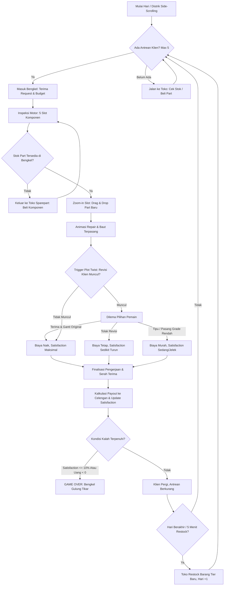

# Game Design Document (GDD)
# Proyek: NGEBENGKEL: CUSTOM STREET CHRONICLES (v0.1)

---

## CHANGELOG
- **v0.1 (Current Version)**:
  - Inisialisasi draft GDD pertama berdasarkan konsep workshop & side-scrolling shop restock.
  - Penjabaran mekanik 5 slot modifikasi motor (Body, Knalpot, Mesin, Roda, Lampu) dengan formula 5 varian per slot (total 3.125 kombinasi procedural).
  - Spesifikasi sistem trade-off: Budget Client vs Player Profit vs Client Satisfaction.
  - Perancangan mekanik "Plot Twist Last-Minute Request" & sistem "Bohongin Klien" (Substitusi Komponen).
  - Perancangan Day/Time Cycle (5 menit shop restock cycle) & kondisi win/lose state.
  - Spesifikasi UI/UX wireframe, scene breakdown, controls, audio design, dan prompt visual art direction hand-drawn funky graffiti (pink/orange/yellow).

---

## DAFTAR ISI
1. [Bab 1 — Game Overview](#bab-1--game-overview)
2. [Bab 2 — Core Gameplay Loop](#bab-2--core-gameplay-loop)
3. [Bab 3 — Gameplay Mechanics & Rules](#bab-3--gameplay-mechanics--rules)
4. [Bab 4 — Scene & Level Architecture](#bab-4--scene--level-architecture)
5. [Bab 5 — UI/UX Specification & Wireframes](#bab-5--uiux-specification--wireframes)
6. [Bab 6 — Economy, Progression & Day Cycle](#bab-6--economy-progression--day-cycle)
7. [Bab 7 — Asset Overview & Art Direction](#bab-7--asset-overview--art-direction)
8. [Bab 8 — Audio Design Specification](#bab-8--audio-design-specification)
9. [Bab 9 — Technical & Production Notes](#bab-9--technical--production-notes)
10. [Bab 10 — Asumsi Desain (Design Assumptions)](#bab-10--asumsi-desain-design-assumptions)

---

## BAB 1 — GAME OVERVIEW

### 1.1 Judul Game
**NGEBENGKEL: Custom Street Chronicles** *(Working Title)*

### 1.2 High Concept / Pitch
Game simulasi manajemen bengkel motor 2D side-scrolling bernuansa *funky hand-drawn graffiti*. Pemain mengelola bengkel modifikasi jalanan, berbelanja suku cadang di toko lokal, dan menghadapi pelanggan eksentrik dengan dilema moral: menuruti revisi dadakan pelanggan demi reputasi atau memanipulasi suku cadang demi mengamankan margin keuntungan.

### 1.3 Genre & Subgenre
- **Genre Utama**: Simulation / Shop Management
- **Subgenre**: 2D Side-scrolling Adventure, Puzzle-Modification, Resource Management

### 1.4 Platform & Target Input
- **Platform Utama**: PC (Steam / itch.io)
- **Input**: Keyboard & Mouse (Mouse Drag & Drop wajib untuk mekanik repair/install)
- **Adaptasi Mobile (Post-MVP)**: Virtual Joystick + Touch Drag-and-Drop

### 1.5 Target Audiens
Pemain usia 15–35 tahun penikmat game manajemen kasual-taktis (seperti *Coffee Talk*, *Potion Craft*, *Dave the Diver*, *Car Mechanic Simulator*) yang menyukai estetika subkultur jalanan, modifikasi motor roda dua, dan humor drama pelanggan lokal.

### 1.6 Mode Pemain
Single-Player (Offline).

### 1.7 Target Durasi & Scope
- **Scope MVP**: 1 Distrik Jalanan (Side-scrolling Hub), 1 Interior Bengkel, 1 Interior Toko Suku Cadang ("Toko Sparepart Jaya"), 5 Hari Operasional in-game (30–45 menit total play session).
- **Target Polishing**: Game Jam / Indie Prototype Showcase.

### 1.8 Engine / Technology Target
- **Engine**: Unity 2D / Godot 4.x
- **Target Resolusi**: 1920x1080 (16:9 widescreen), Scalable UI.

### 1.9 Unique Selling Points (USP)
1. **Dynamic Modular Motorcycle Assembly**: 5 slot komponen dengan 5 tingkatan varian modular menghasilkan $5^5 = 3.125$ kombinasi visual motor procedural.
2. **Moral Dilemma & The "Bohongin Klien" Mechanic**: Kebebasan memasang grade komponen di bawah pesanan saat budget klien minus, dengan risiko kepuasan anjlok atau terbongkar.
3. **The "Revisi Dadakan" (Plot Twist Request)**: Klien yang plin-plan memicu adaptasi taktik real-time di meja perakitan.
4. **Vibrant Funky Graffiti Aesthetics**: Visual 2D hand-drawn penuh energi dengan palet dominan Neon Pink, Electric Orange, dan Sun Yellow, dipadu musik Hip-Hop/Lo-Fi beat santai.

### 1.10 Design Pillars
1. **Tactile Customization**: Setiap tindakan membongkar, menyeret komponen, dan mengencangkan baut harus memuaskan (juicy visual & audio feedback).
2. **Calculated Risk vs. Reward**: Menjadi montir jujur membangun kepuasan jangka panjang namun berisiko bangkrut; menjadi montir culas memberi uang cepat namun mengancam reputasi bengkel.
3. **Street Culture Authenticity**: Suasana bengkel lokal yang hidup, interaksi santai, celengan koin ayam jago tradisional, dan celotehan khas pelanggan bengkel motor.

### 1.11 Player Fantasy
Menjadi "Maestro Modifikasi Kaki Lima" yang disegani: mengerti seluk-beluk motor bobrok hingga motor drag balap, menghadapi pelanggan cerewet, dan membangun kerajaan bengkel dari nol.

### 1.12 Scope Boundary
- **Dalam MVP (v0.1)**:
  - 1 Tipe Base Motor (Scooter/Bebek Chassis).
  - 5 Bagian Motor: Body, Knalpot, Mesin, Roda, Lampu.
  - Masing-masing bagian memiliki 5 varian tetap (2 Murah, 2 Sedang, 1 Mahal).
  - Sistem antrean walk-in pelanggan (maksimal 5 orang berjejer di jalanan).
  - Siklus waktu restock Toko Sparepart (timer 5 menit in-game day cycle).
  - Core parameters: Player Money & Client Satisfaction Rate (0–100%).
- **Luar Scope MVP (Sengaja Ditunda)**:
  - Test drive motor di jalan raya.
  - Custom painting spray manual warna bebas.
  - Multi-vehicle type (Chopper, Sport Ninja, Moge).
  - Sistem sewa montir tambahan / staff AI.

---

## BAB 2 — CORE GAMEPLAY LOOP

### 2.1 Alur Siklus Utama (Core Loop)
1. **Explore & Queue Check**: Pemain berjalan di distrik side-scrolling (A/D), melihat antrean pelanggan (maksimal 5 orang) di depan bengkel.
2. **Receive Order**: Pemain masuk ke dalam Bengkel, berhadapan dengan klien aktif, mendengarkan permintaan modifikasi awal beserta anggaran (*budget limit*).
3. **Inventory & Shop Phase**: Pemain memeriksa stok bengkel. Jika ada part yang kurang, pemain keluar ke Toko Sparepart untuk membeli komponen yang dibutuhkan.
4. **Assembly & Installation**: Di meja bengkel, pemain mengklik slot bagian motor (kamera zoom-in), memilih part dari inventory atas, dan melakukan drag-and-drop ke motor (animasi repair/pasang).
5. **The Plot Twist Event**: Saat pengerjaan mencapai 80-100%, klien memunculkan dialog revisi dadakan ("*Eh Bang, kayaknya gak jadi knalpot itu deh...*").
6. **Player Decision**:
   - *Accept Revision (Jujur)*: Ganti komponen sesuai permintaan baru, resiko boncos jika budget klien tidak menutup biaya.
   - *Reject Revision*: Tolak mentah-mentah. Pengerjaan selesai cepat, uang aman, kepuasan turun moderat.
   - *Deceive / Substitute (Culas)*: Pasang komponen grade lebih murah tapi mengklaim barang sesuai selera baru. Margin profit tinggi, resiko kepuasan jeblok drastis jika ketahuan.
7. **Delivery & Payout**: Klien membayar, koin dimasukkan ke Celengan Bengkel, parameter Satisfaction & Cash diperbarui.
8. **Day End & Restock**: Pergantian hari memicu katalog Toko Sparepart diperbarui dengan tier barang yang lebih tinggi.

### 2.2 Mermaid Flowchart Core Loop



---

## BAB 3 — GAMEPLAY MECHANICS & RULES

### 3.1 Player Actions (Aksi Pemain)

#### 1. Traversal Jalanan (World Exploration)
- **Input**: Tombol `A` / `D` (atau `Arrow Left` / `Arrow Right`).
- **Deskripsi**: Pemain bergerak 2D side-scrolling secara horizontal di depan ruko bengkel dan toko sparepart.
- **Batasan**: Tidak bisa bergerak saat berada di dalam mini-game inspeksi/zoom motor atau saat dialog berlangsung.

#### 2. Building Interaction (Masuk/Keluar Gedung)
- **Input**: Tombol `E` atau `W` saat berada di dekat pintu bertanda prompt.
- **Target Valid**: Pintu Bengkel Utama & Pintu Toko Sparepart Jaya.
- **Respons Sistem**: Layar melakukan transisi smooth cross-fade interior/eksterior.

#### 3. Part Slot Selection (Inspect / Zoom-in)
- **Input**: Klik Kiri Mouse (`LMB`) pada salah satu dari 5 hitbox bagian motor di bengkel.
- **Respons Sistem**: Kamera melakukan lerp zoom-in fokus ke area part yang dipilih. UI Tray atas terbuka menampilkan katalog part yang dimiliki player untuk kategori tersebut.

#### 4. Part Installation (Drag & Drop Repair)
- **Input**: Klik & Tahan (`Hold LMB`) pada kartu part di UI tray atas, geser (`Drag`) ke arah motor, lalu lepaskan (`Release`) di atas siluet part.
- **Feedback**:
  - *Valid Drop*: Efek suara hentakan kunci pas (*clack-clank*), animasi partikel percikan api kecil, pop-up icon perkakas berputar selama 0.8 detik, part visual langsung berganti.
  - *Invalid Drop*: Kartu part meluncur kembali ke tray atas dengan suara *swoosh-fail*.

#### 5. Celengan Bengkel Interaction (Piggy Bank / Cash Box)
- **Input**: Klik Kiri Mouse (`LMB`) pada objek Celengan Ayam di sebelah kiri meja kerja.
- **Respons**: Menampilkan detail ringkasan keuangan hari ini (Pendapatan Kotor, Pengeluaran Modal Suku Cadang, Margin Laba Bersih, Saldo Aktif).

---

### 3.2 Control Scheme

| Action | Keyboard & Mouse (Default) | Gamepad (Opsional) | Fungsi | Kondisi / Keterangan |
| :--- | :--- | :--- | :--- | :--- |
| **Move Left** | `A` / `Left Arrow` | D-Pad Left / L-Stick Left | Bergerak ke kiri di area jalanan | Mode World Explore saja |
| **Move Right** | `D` / `Right Arrow` | D-Pad Right / L-Stick Right | Bergerak ke kanan di area jalanan | Mode World Explore saja |
| **Interact / Enter** | `E` / `Space` | Button South (`A` Xbox / `X` PS) | Masuk gedung / Bicara ke NPC | Dekat pintu/NPC dengan prompt |
| **Select / Inspect** | `Mouse Hover` + `LMB` | L-Stick Pointer + Button South | Memilih bagian motor / menu | Mode Bengkel & Toko |
| **Drag & Drop Part**| `LMB Click & Drag` | Button South Hold + R-Stick | Memasang komponen ke motor | Dari tray atas ke motor |
| **Cancel / Zoom Out**| `RMB` / `Esc` | Button East (`B` Xbox / `O` PS) | Keluar dari zoom slot / tutup UI | Mengembalikan kamera normal |
| **Open Ledger** | `Tab` | Button North (`Y` Xbox / `Triangle` PS) | Cek status reputasi & saldo | Tersedia kapan saja |
| **Pause Game** | `Esc` | Start / Options | Buka Pause Menu | Gameplay berhenti |

---

### 3.3 Movement & Physics System
- **Tipe Gerakan**: Kinematic 2D Side-scroller (tanpa jump/gravity kompleks).
- **Kecepatan Gerak (Walk Speed)**: $220\text{ pixel/detik}$.
- **Akselerasi / Deselerasi**: Instan ($0.05\text{ detik}$) untuk responsivitas presisi di game berfokus manajemen.
- **Collision World**: Static 2D Box Collider di ujung kiri distrik (tembok gang) dan ujung kanan distrik (barikade jalan). Pemain tidak bisa tembus batas jalanan.

---

### 3.4 Motor Modular System: The 5-Slot Architecture
Motor klien memiliki Base Frame (Sasis Rangka) tunggal yang menjadi jangkar untuk 5 sub-bagian modular. Masing-masing bagian memiliki 5 tingkat varian visual dan spesifikasi harga.

$$\text{Total Kombinasi Unik} = 5_{\text{Body}} \times 5_{\text{Knalpot}} \times 5_{\text{Mesin}} \times 5_{\text{Roda}} \times 5_{\text{Lampu}} = 3.125\text{ Variasi Motor}$$

#### Klasifikasi Tier Komponen:
1. **Tier 1 (Murah A)**: Kualitas Standar Bekas, visual berkarat/kusam, harga modal terendah.
2. **Tier 2 (Murah B)**: Kualitas Standar Pabrik (OEM Basic), visual polos rapi.
3. **Tier 3 (Sedang A)**: Kualitas Street Sport, visual warna kontras/matte finish.
4. **Tier 4 (Sedang B)**: Kualitas Custom Thailook / Retro Classic, visual chrome/aksen neon.
5. **Tier 5 (Mahal / Racing)**: Kualitas Titanium / Full-Custom Carbon Fiber, visual menyala/holografik street art.

#### Tabel Katalog Komponen Bengkel (25 Varian):

| Slot ID | Slot Name | Varian ID | Nama Varian | Tier | Modal Beli | Harga Jual Standar | Value Skor |
| :--- | :--- | :--- | :--- | :--- | :--- | :--- | :--- |
| **SLOT-01** | Body | `BD-01` | Body Karat Dempul | Murah A | Rp 50.000 | Rp 80.000 | 10 |
| | | `BD-02` | Body Standar Pabrikan Polos | Murah B | Rp 100.000 | Rp 150.000 | 25 |
| | | `BD-03` | Body Matte Street Pink | Sedang A | Rp 220.000 | Rp 320.000 | 50 |
| | | `BD-04` | Body Retro Skater Yellow | Sedang B | Rp 350.000 | Rp 500.000 | 75 |
| | | `BD-05` | Body Full Graffiti Carbon | Mahal | Rp 700.000 | Rp 1.050.000 | 120 |
| **SLOT-02** | Knalpot | `EX-01` | Knalpot Standar Keropos | Murah A | Rp 30.000 | Rp 55.000 | 10 |
| | | `EX-02` | Knalpot Hitam Bobokan | Murah B | Rp 75.000 | Rp 120.000 | 25 |
| | | `EX-03` | Knalpot Stainless Pelangi | Sedang A | Rp 180.000 | Rp 270.000 | 50 |
| | | `EX-04` | Knalpot Bass Bulat Gahar | Sedang B | Rp 280.000 | Rp 400.000 | 75 |
| | | `EX-05` | Knalpot Titanium Racing Burn | Mahal | Rp 600.000 | Rp 900.000 | 120 |
| **SLOT-03** | Mesin | `EN-01` | Blok Mesin 100cc Ngebul | Murah A | Rp 120.000 | Rp 190.000 | 10 |
| | | `EN-02` | Blok Mesin 110cc Refurbished| Murah B | Rp 250.000 | Rp 380.000 | 25 |
| | | `EN-03` | Mesin Bore-Up Harian 130cc | Sedang A | Rp 500.000 | Rp 720.000 | 50 |
| | | `EN-04` | Mesin DOHC Head CNC | Sedang B | Rp 800.000 | Rp 1.150.000 | 75 |
| | | `EN-05` | Mesin Twin-Turbo Drag Strip | Mahal | Rp 1.600.000| Rp 2.400.000 | 120 |
| **SLOT-04** | Roda | `WH-01` | Velg Kaleng Peang & Ban Gundul| Murah A | Rp 40.000 | Rp 70.000 | 10 |
| | | `WH-02` | Velg Jari-Jari Ruji Standar | Murah B | Rp 90.000 | Rp 140.000 | 25 |
| | | `WH-03` | Velg Racing Cast Star Orange| Sedang A | Rp 200.000 | Rp 300.000 | 50 |
| | | `WH-04` | Velg Ruji Gold Donut Tire | Sedang B | Rp 320.000 | Rp 470.000 | 75 |
| | | `WH-05` | Velg Monoblock Forged Pink | Mahal | Rp 650.000 | Rp 980.000 | 120 |
| **SLOT-05** | Lampu | `LT-01` | Batok Lampu Retak Dop Redup | Murah A | Rp 20.000 | Rp 35.000 | 10 |
| | | `LT-02` | Lampu Bohlam Halogen Kuning | Murah B | Rp 50.000 | Rp 80.000 | 25 |
| | | `LT-03` | Lampu Daymaker LED Strip | Sedang A | Rp 130.000 | Rp 200.000 | 50 |
| | | `LT-04` | Dual Projector Demon Eye | Sedang B | Rp 220.000 | Rp 330.000 | 75 |
| | | `LT-05` | Cyberpunk Neon RGB Scanner | Mahal | Rp 450.000 | Rp 700.000 | 120 |

---

### 3.5 Client Order, Budget & Trade-off System

Setiap pelanggan yang masuk memiliki profil acak:
1. **Nama & Persona Klien** (Contoh: *Doni Skater*, *Bu Tejo Arisan*, *Rizky Anak Sunmori*).
2. **Current Motor State**: Kondisi awal acak dari 5 bagian motor.
3. **Target Order**: Permintaan penggantian 1 s/d 3 bagian motor dengan tier tertentu.
4. **Client Budget ($\text{B}_{\text{client}}$)**: Jumlah uang maksimal yang dimiliki klien (biasanya bernilai $\text{Harga Jual Standar} + [0\% \dots 20\%]$ toleransi).

#### Formula Kepuasan (Satisfaction Formula):
Kepuasan pelanggan dinilai dari skala 0% hingga 100%:

$$\Delta \text{Satisfaction} = \text{Base Satisfaction (70\%)} + \text{Tier Accuracy Bonus} - \text{Budget Penalty} \pm \text{Plot Twist Decision Effect}$$

1. **Pemasangan Sesuai Target Order**: $+25\%$ Satisfaction.
2. **Pemasangan Tier Lebih Tinggi dari Order (Hadiah Bengkel)**: $+30\%$ Satisfaction (tetapi pemain rugi modal jika harga melebihi budget).
3. **Pemasangan Tier Lebih Rendah (Mekanik Bohongin Klien)**:
   - Jika order minta **Tier 5 (Mahal)** tapi dipasang **Tier 3 (Sedang)**:
     - Klien tidak langsung sadar saat serah terima.
     - Kepuasan hanya bernilai dasar $+5\%$ hingga $+10\%$ (karena tidak mencapai ekspektasi estetika maksimalnya).
     - Margin uang pemain tetap untung besar karena klien membayar lunas sesuai anggapan awal.
   - Jika dipasang **Tier 1 (Murah Sekali/Bekas)**:
     - Pelanggan curiga: Klien mendengarkan suara knalpot/melihat cat lecet.
     - Penalti Satisfaction drastis: $-35\%$.
     - Celoteh marah muncul di dialog.

---

### 3.6 The Plot Twist Mechanic ("Revisi Dadakan")
Ketika pemain sudah selesai memasang komponen yang diminta (progress pengerjaan mencapai 100%), ada peluang $45\%$ klien memotong alur dengan balon dialog panik/plin-plan:

> **Contoh Kasus**: Klien meminta ganti knalpot standar ke Knalpot Racing Titanium (Tier 5, Jual: Rp 900.000). Budget awal klien pas-pasan: Rp 950.000.  
> Tiba-tiba klien berteriak:  
> *"Duh Bang, sorry banget barusan ditelpon bini suruh beli beras! Duit gue sisa 400 ribu doang, tapi knalpotnya pengen tetep keliatan gaya kayak racing! Gimana dong?!"*

Pemain dihadapkan pada 3 pilihan tombol UI:

```
[ PILIHAN REVISI KLIEN ]
1. [TERIMA & TURUNKAN SESUAI BUDGET] (Pasang Tier 3 Sedang - Rp 270.000)
   -> Dampak: Uang aman (untung bersih Rp 90.000), Satisfaction: +15% (Netral/Aman).
2. [TETAP PASANG TIER 5 & TANGGUNG RUGI] (Amal / Bikin Klien Terkesima)
   -> Dampak: Boncos parah (Player tekor biaya modal), Satisfaction: +40% (Reputasi Melejit).
3. [TOLAK MENTAH-MENTAH] ("Gak bisa Bos, udah kepasang!")
   -> Dampak: Klien terpaksa bayar sisa hutang atau batal transaksi, Satisfaction: -30%.
4. [AKAL-AKALAN / BOHONG] (Pasang Knalpot Bobokan Tier 2 dicat perak, klaim ini Tier 4)
   -> Dampak: Modal Rp 75.000, Tarik uang klien Rp 400.000. Laba Rp 325.000. Satisfaction: +5% (atau -40% bila inspeksi akhir gagal).
```

---

### 3.7 Win, Lose & Fail States

#### 1. Lose State (Game Over)
Pemain kalah jika salah satu dari dua kondisi ini terjadi:
- **Reputation Bankruptcy**: Rata-rata *Client Satisfaction Rate* mencapai $\le 10\%$. Bengkel dicap sebagai "Bengkel Penipu" di media sosial lokal. Tidak ada lagi pelanggan yang mau mengantre di depan ruko. Pendapatan terhenti total.
- **Financial Bankruptcy**: Saldo uang pemain di Celengan bernilai $< \text{Rp } 0$ (minus) pada akhir hari operasional dan tidak mampu membeli stok suku cadang paling murah sekalipun.

#### 2. Win State (Day Completion & Target Benchmark)
- **Sesi Harian Sukses**: Berhasil bertahan hingga Hari ke-5 tanpa bangkrut, melayani minimal 15 pelanggan, serta mempertahankan Satisfaction Rate di atas $\ge 75\%$.
- **Endless Expansion**: Terbukanya lisensi "Distrik Modifikasi Balap" (Katalog Tier 5 permanen di toko).

#### 3. Retry & Reset Rules
- Jika Game Over, pemain dapat memilih **Restart Day** (mengulang hari aktif dengan saldo dan inventaris awal hari tersebut) atau **New Game**.
- Seluruh antrean harian dan stok toko akan di-roll ulang secara deterministik.

---

## BAB 4 — SCENE & LEVEL ARCHITECTURE

### 4.1 Daftar Scene Proyek

| Scene ID | Nama Scene | Tipe / Arsitektur | Elemen Kunci | Input Transisi | Keluar Ke | Status |
| :--- | :--- | :--- | :--- | :--- | :--- | :--- |
| `SC-00` | MainMenuScene | Full Scene Canvas | Logo Graffiti, Play Button, Options, Credits | Klik Start | `SC-01` | Rencana |
| `SC-01` | StreetHubScene | 2D World Side-scroller | Ruko Bengkel, Toko Sparepart, Antrean NPC (Max 5), Traffic Latar Belakang | Masuk Bengkel (`E`) / Masuk Toko (`E`) | `SC-02` / `SC-03` | Rencana |
| `SC-02` | WorkshopInteriorScene | 2D Focused Stage | Motor Klien di Paddock Tengah, NPC Pemilik (Kiri), Player Avatar (Kanan), Celengan Ayam (Meja Kiri), UI Tray Komponen (Atas) | Selesai Servis / Tekan Pintu Keluar | `SC-01` | Rencana |
| `SC-03` | PartsShopInteriorScene | 2D Shop Counter | Etalase Rak Komponen, Kasir NPC Toko, Timer Restock (5 Menit), Cart Checkout | Tekan Pintu Keluar / Beli Selesai | `SC-01` | Rencana |
| `SC-04` | DaySummaryModal | UI Overlay Popup | Rekap Laba/Rugi Harian, Rating Bintang Kepuasan, Tombol "Lanjut Hari Berikutnya" | Klik "Mulai Hari Baru" | `SC-01` | Rencana |
| `SC-05` | GameOverScene | Full Scene Screen | Visual Ruko Bengkel Ditutup Garis Polisi/Digembok, Skor Statistik, Tombol Retry | Klik "Coba Lagi" / "Menu Utama" | `SC-01` / `SC-00` | Rencana |

---

### 4.2 Struktur Level: Street Hub (SC-01)
- **Layout Area**: Panjang koridor horizontal jalanan sebesar $2.400\text{ px}$.
- **Landmark**:
  - **Paling Kiri ($x = 200$)**: Ruko Toko Sparepart Jaya (Papan nama neon kuning berkedip).
  - **Tengah ($x = 1.000 - 1.400$)**: Area Antrean Pelanggan trotoar jalan (NPC berdiri berjejer maksimal 5 orang).
  - **Paling Kanan ($x = 1.800$)**: Ruko Bengkel "Custom Street" milik pemain (Pintu rolling door terbuka, papan graffiti warna pink-orange).
- **NPC Spawning**:
  - Setiap $30 - 60\text{ detik}$, pelanggan baru datang dari ujung kanan layar dan bergabung ke barisan antrean hingga kuota 5 orang penuh.

```
[WORLD EXPLORATION: 2D SIDE-SCROLLING VIEWPORT]
+----------------------------------------------------------------------------------------------------+
| [HUD: Saldo: Rp 1.250.000]   [Satisfaction: 85%]   [Jam Operasional: 14:30 | Hari 2]               |
|                                                                                                    |
|   +-------------------+                     TROTOAR ANTREAN                      +---------------+ |
|   | TOKO SPAREPART    |              (Maksimal 5 Pelanggan Antre)                | BENGKEL KITA  | |
|   | "JAYA ABADI"      |                                                          | [Rolling Door]| |
|   |                   |        NPC-1      NPC-2     NPC-3    NPC-4    NPC-5      |               | |
|   | [Pintu Toko: E]   |        (Motor)   (Motor)   (Motor)  (Motor)  (Motor)     | [Pintu: E]    | |
|===+===================+==========================================================+===============+=|
| <--- Area Pejalan Kaki (Tombol A / D Untuk Eksplorasi) ----------------------------->              |
+----------------------------------------------------------------------------------------------------+
```

---

## BAB 5 — UI/UX SPECIFICATION & WIREFRAMES

### 5.1 UI Design Direction
- **Estetika**: Funky Street Graffiti, Doodle pop-art, garis outline tebal hitam ($4\text{px}$ ink contour), stiker bergerigi (*sticker bomb*), font bold bergaya tag kaligrafi jalanan atau retro blocky font.
- **Palet Warna Utama**:
  - **Neon Pink** (`#FF1493` / `#FF2A85`): Aksen tombol utama, seleksi aktif, highlights.
  - **Electric Orange** (`#FF6600`): Background banner header, notifikasi, peringatan revisi.
  - **Sun Yellow** (`#FFE600`): Mata uang / koin, label harga, status kepuasan tinggi.
  - **Asphalt Charcoal** (`#1C1B22`): Panel dasar, background box kontras, teks terbaca jelas.
  - **Chalk White** (`#F8F9FA`): Teks utama dan ikonografi.
- **Hierarki Informasi**:
  1. *Primer*: Uang Pemain, Indikator Kepuasan Klien, Permintaan Klien Aktif.
  2. *Sekunder*: Tray Komponen Motor, Status Ketersediaan Stok.
  3. *Kontekstual*: Tooltip Harga Part, Peringatan Budget Minus Klien.

---

### 5.2 Gameplay HUD Specification

| Elemen HUD | Posisi Layar | Konten & Sumber Data | Format Visual | Kapan Berubah |
| :--- | :--- | :--- | :--- | :--- |
| **Cash Display** | Top-Left | Saldo Celengan (`GameManager.Cash`) | Ikon Celengan Ayam + `Rp 1.500.000` (Kuning) | Setiap ada transaksi beli/jual |
| **Satisfaction Meter** | Top-Center | Rata-rata Kepuasan (`ReputationManager.Value`) | Bar meter melengkung graffiti + Angka persentase (Pink-Green) | Setiap klien selesai diservis |
| **Day & Restock Clock**| Top-Right | Timer Restock Toko (`ShopTimer`) & Hari Aktif | `Hari 2 - 03:45 Restock` + Ikon Jam Analog | Berkurang tiap detik |
| **Active Client Tracker**| Bottom-Left | Sisa Antrean Jalanan (`QueueCount / 5`) | Ikon 5 helm motor (menyala sesuai jumlah yang antre)| Saat klien datang/pergi |
| **Cancel / Exit Button**| Bottom-Right | Tombol kembali ke jalanan | Tombol `[ KELUAR - ESC ]` bentuk stiker miring | Selalu aktif di bengkel/toko |

---

### 5.3 Spesifikasi Layar Bengkel Utama (SC-02: Workshop Interior)

- **Tujuan**: Ruang kerja utama tempat pemain berinteraksi dengan motor, membaca permintaan pemilik, mengganti suku cadang, dan menghadapi plot twist revisi.
- **Kondisi Tampil**: Saat pemain menekan tombol `E` di depan pintu bengkel pada `SC-01`.
- **Komposisi Layout**:
  - **Kiri Bawah**: Meja kasir sederhana berisi **Celengan Ayam Jago Tradisional** (interaktif) dan NPC pemilik motor yang berdiri menunggu dengan ekspresi wajah responsif.
  - **Tengah Layar**: Paddock motor hidrolik dengan Motor Klien menghadap ke kanan. Terdapat 5 titik hitbox interaktif: **Body, Knalpot, Mesin, Roda, Lampu**.
  - **Kanan Layar**: Avatar Pemain (memegang kunci inggris, memakai celemek bengkel).
  - **Bagian Atas Layar**: Horizontal Slide-out Tray yang berisi 5 slot kartu part dari inventaris.

#### Wireframe Berbasis Teks: Interior Bengkel

```
+----------------------------------------------------------------------------------------------------+
| [Rp 1.250.000]   [Satisfaction: 85%]                 [BAGIAN AKTIF: RODA (WHEELS)]     [X Batal]   |
| +------------------------------------------------------------------------------------------------+ |
| | [TRAY PART ATAS]:                                                                              | |
| |  +------------+  +------------+  +------------+  +------------+  +------------+                | |
| |  | WH-01      |  | WH-02      |  | WH-03      |  | WH-04      |  | WH-05      |  [Scroll >]    | |
| |  | Kaleng Rp0 |  | Ruji Rp90k |  | Racing Rp200|  | Gold Rp320k|  | Forged Pink|                | |
| |  | [Stok: 2]  |  | [Stok: 0]  |  | [Stok: 1]  |  | [Stok: 0]  |  | [Stok: 0]  |                | |
| |  +------------+  +------------+  +------------+  +------------+  +------------+                | |
| +------------------------------------------------------------------------------------------------+ |
|                                                                                                    |
|    +-------------------+                  [AREA MOTOR KLIEN]                    +---------------+  |
|    | BALON DIALOG      |                 (5 Hotspot Klik Interaktif)            | AVATAR PLAYER |  |
|    | "Gue pengen roda  |                     (5) LAMPU                          | (Montir Keren)|  |
|    | racing oranye!    |                       \       (1) BODY                 |               |  |
|    | Budget: Rp 350rb" |                        [O]   ___/____                  |               |  |
|    +-------------------+                     _  / \  |   ==   \                 |   (o_o)       |  |
|              \                              (3) MESIN \________\                |   <)  )---c   |  |
|               \                                \    [ (O)==== ]                 |    /  \       |  |
|             (o_o)                               \  /      (2) KNALPOT           |               |  |
|             <)  ) [NPC KLIEN]               (4) RODA-----(O)                    |               |  |
|   ========== /  \ ==============================================================+===============+  |
|   [CELENGAN AYAM]   |                  [PADDOCK STAND MOTOR]                    | MEJA PERKAKAS |  |
|   [Klik: Buka Kas]  |                                                           |               |  |
+----------------------------------------------------------------------------------------------------+
```

---

### 5.4 Spesifikasi Layar Toko Sparepart (SC-03: Parts Shop Interior)

- **Tujuan**: Tempat pemain membelanjakan modal untuk menyetok komponen motor yang akan dipasang di bengkel.
- **Kondisi Tampil**: Saat pemain menekan tombol `E` di depan Toko Sparepart Jaya pada `SC-01`.
- **Perilaku Khusus (5-Minute Restock Timer)**:
  - Toko memiliki stok terbatas acak per siklus 5 menit.
  - Setiap kali timer habis, bel toko berbunyi (*ding-dong!*), stok diperbarui.
  - Seiring naiknya hari ($Day \ge 2$), peluang munculnya part Tier 3, 4, dan 5 semakin tinggi.

#### UI Table Elemen Toko:

| Komponen UI | Posisi | Fungsi | Aksi Pemain |
| :--- | :--- | :--- | :--- |
| **Grid Rak Toko** | Tengah Layar (Katalog 3x3) | Menampilkan part yang dijual saat ini beserta tier & stok | Klik kartu part untuk menambah ke keranjang |
| **Restock Countdown**| Atas Tengah | Menghitung mundur waktu perputaran stok baru | Display dinamis `04:12 Hingga Barang Baru!` |
| **Keranjang Belanja**| Kanan Layar | Total harga barang yang dipilih | Menampilkan kalkulasi total modal keluar |
| **Tombol Beli (Checkout)**| Kanan Bawah | Membayar belanjaan | Saldo celengan berkurang, stok bertambah ke bengkel |
| **Tombol Keluar**| Kiri Bawah | Kembali ke jalanan | Menutup toko tanpa belanja |

---

## BAB 6 — ECONOMY, PROGRESSION & DAY CYCLE

### 6.1 Parameter Keuangan & Formula Laba
1. **Modal Awal Hari 1**: $\text{Rp } 400.000$ (Cukup untuk membeli 2–3 part murah & sedang).
2. **Margin Keuntungan Standar**: Rata-rata margin markup bengkel adalah $40\% - 60\%$ dari harga modal toko.
3. **Penyimpanan Uang (Celengan Ayam)**: Uang yang diperoleh langsung ditampung di sini. Pemain tidak dikenakan bunga pinjaman pada MVP, namun uang tidak boleh minus di penutupan hari.

### 6.2 Sistem Waktu & Progresi Harian
- **1 Hari In-Game** = 5 Menit Waktu Nyata (300 Detik).
- **Struktur Jam Operasional**:
  - `08:00 WIB` - Pagi Hari: Toko buka, 2 klien pertama datang ke antrean.
  - `12:00 WIB` - Siang Hari: Antrean mencapai puncak (3–5 pelanggan).
  - `17:00 WIB` - Sore Hari: Toko restock batch ke-2, klien terakhir diservis.
  - `20:00 WIB` - Tutup Bengkel: Evaluasi harian (Layar `SC-04`).

#### Tabel Progresi Hari:

| Hari | Maksimum Antrean Harian | Tier Part Tersedia di Toko | Ekspektasi Budget Klien | Frekuensi Plot Twist |
| :--- | :--- | :--- | :--- | :--- |
| **Hari 1** | 4 Klien | Tier 1 (100%), Tier 2 (80%), Tier 3 (20%) | Rendah (Rp 80k - Rp 250k) | Rendah (20% Klien) |
| **Hari 2** | 5 Klien | Tier 1 (80%), Tier 2 (100%), Tier 3 (50%) | Menengah-Bawah (Rp 150k - Rp 450k)| Normal (35% Klien) |
| **Hari 3** | 6 Klien (Bergantian) | Tier 2 (70%), Tier 3 (100%), Tier 4 (40%) | Menengah (Rp 300k - Rp 800k) | Tinggi (50% Klien) |
| **Hari 4** | 7 Klien (Bergantian) | Tier 3 (80%), Tier 4 (100%), Tier 5 (30%) | Tinggi (Rp 500k - Rp 1.500k) | Sangat Tinggi (60% Klien)|
| **Hari 5** | 8 Klien (Final Rush) | Semua Tier Terbuka (Tier 5: 60%) | Sultan / Komunitas Balap (s/d Rp 3 Juta)| Ekstrem (75% Klien) |

---

## BAB 7 — ASSET OVERVIEW & ART DIRECTION

### 7.1 Visual Art Direction & Color Palette
- **Style**: Hand-drawn 2D Cartoon dengan *Street Punk & Graffiti Influence*.
- **Karakter**: Proporsi semi-chibi (kepala sedikit lebih besar, tangan ekspresif), gestur komikal saat panik atau puas.
- **Environment**: Ruko kota tropis khas Asia Tenggara / Indonesia, dinding penuh stiker modifikasi, coretan cat semprot graffiti, kabel semrawut yang artistik, pot tanaman pinggir jalan.
- **Palet Warna Inti**:
  - Neon Magenta Pink: `#FF1493`
  - Energetic Street Orange: `#FF6600`
  - Sunburst Yellow: `#FFE600`
  - Off-Black Asphalt: `#18181F`
  - Mint Turquoise Aksen: `#00F5D4`

---

### 7.2 Visual Reference Concept Prompts

#### Visual: Key Art & Gameplay Hero View
*Konsep visual utama yang menampilkan suasana bengkel funky, motor modifikasi modular, dan karakter montir serta pelanggan.*

> **Prompt Gambar (Dapat Digunakan Ulang):**  
> `2D hand-drawn concept art of a funky motorcycle custom repair shop, street graffiti style, vibrant color palette featuring neon pink, electric orange, bright yellow, and deep charcoal. In the center, a cool modular 2D scooter on a hydraulic lift with visible swappable parts: custom exposed engine, graffiti body panels, chrome exhaust pipe, street tires. On the left, an eccentric hipster client with sunglasses looking impatient. On the right, a young Indonesian mechanic with a denim apron holding a wrench. On the counter, a traditional ceramic rooster coin piggy bank. Thick black comic outlines, dynamic shadows, sticker-bomb details on the background brick walls, cozy indie game aesthetic, 16:9 aspect ratio, high detail.`

#### Visual: Street Hub Side-Scrolling Scene (SC-01)
*Pemandangan jalanan eksterior 2D tempat pemain berjalan antara Toko Sparepart dan Bengkel.*

> **Prompt Gambar:**  
> `2D side-scrolling platformer background art, vibrant street alley in Southeast Asia, hand-drawn graffiti style. On the far left, a quirky motorcycle parts shop with glowing yellow neon signs. On the right, an open garage workshop with bright pink and orange graffiti murals. In the middle pavement, a line of 5 eccentric diverse comic characters standing with their unique motorbikes waiting in queue. Hand-drawn cartoon aesthetic, thick outlines, bold colors, sunny late afternoon lighting, asphalt ground with street chalk markings, casual simulation game vibe.`

#### Visual: Workshop Assembly Zoom-In HUD (SC-02)
*Tampilan gameplay meja kerja saat pemain melakukan zoom-in dan drag-and-drop komponen.*

> **Prompt Gambar:**  
> `2D video game UI screenshot, motorcycle customization mechanics. Close-up view of a custom motorcycle wheel and exhaust frame in a workshop. At the top of the screen, a clean horizontal UI tray with funky rounded cards showing different modular motorcycle wheel rims and exhaust pipes with price tags and stock count. A semi-transparent ghost blueprint overlay showing where to drag-and-drop the selected wheel part. Bold pop-art aesthetic, vibrant orange and pink color scheme, comic book sound effect text 'CLANG!' in the corner, crisp graphic vector art, casual simulation UI.`

---

## BAB 8 — AUDIO DESIGN SPECIFICATION

### 8.1 Music & BGM
- **Distrik Jalanan (Street Hub)**: BGM Lo-Fi Hip Hop santai bertempo $85\text{ BPM}$ dengan petikan gitar elektrik santai, beat drum renyah, dan suara latar ambient jalanan (suara klakson jauh, obrolan samar, angin sepoi).
- **Dalam Bengkel (Repair Mode)**: Funk / Upbeat Boom-Bap bertempo $105\text{ BPM}$ yang memicu semangat bekerja, dipadukan suara ritmis ketukan perkakas mekanik.
- **Dalam Toko Sparepart**: City Pop / elevator synth groovy khas toserba belanja santai.
- **Kondisi Kritis (Satisfaction Rendah / Waktu Habis)**: Tempo BGM meningkat dengan distorsi bass berdenyut memberikan urgensi kepanikan.

### 8.2 Sound Effects (SFX) Priority Table

| Sound ID | Event Pemicu | Tipe Suara / Deskripsi Audio | Prioritas |
| :--- | :--- | :--- | :--- |
| `SFX_WRENCH_01` | Klik/Pilih slot motor | Suara *clack* logam kunci pas menyentuh mur baut | P0 (MVP Wajib) |
| `SFX_INSTALL_SUCCESS` | Drag & Drop part sukses | Suara impact mekanik kencang + desis kompresor angin (*tsshh-clank!*) | P0 (MVP Wajib) |
| `SFX_INSTALL_FAIL` | Salah pasang / slot tidak cocok | Suara *thud* tumpul karet membal | P1 |
| `SFX_PIGGY_COIN` | Pembayaran / Koin masuk | Suara koin logam berdenting jatuh ke dalam celengan tanah liat | P0 (MVP Wajib) |
| `SFX_PLOT_TWIST` | Revisi klien muncul | Suara *record scratch* mendadak diikuti terompet komedi meleset | P0 (MVP Wajib) |
| `SFX_CLIENT_HAPPY` | Pelanggan puas | Suara tawa girang / jempol *ting!* | P1 |
| `SFX_CLIENT_ANGRY` | Pelanggan marah / tertipu | Klakson motor berisik bernada sumbang + gerutuan | P1 |
| `SFX_DOOR_BELL` | Masuk ruko toko / bengkel | Suara bel kerincing kuningan pintu klasik | P2 |

---

## BAB 9 — TECHNICAL & PRODUCTION NOTES

### 9.1 Data Structure: Komponen Motor (JSON Schema)
```json
{
  "part_id": "EX-03",
  "slot_category": "Exhaust",
  "name": "Knalpot Stainless Pelangi",
  "tier": 3,
  "cost_price": 180000,
  "selling_price": 270000,
  "satisfaction_weight": 50,
  "sprite_layer": "layer_exhaust_back",
  "icon_path": "sprites/ui/parts/ex_03.png",
  "prefab_path": "prefabs/parts/exhaust_03.prefab"
}
```

### 9.2 Risiko Produksi & Mitigasi
1. **Risiko Pembuatan 3.125 Varian**:
   - *Mitigasi*: Jangan menggambar 3.125 motor utuh! Terapkan sistem **Paper-doll Layering 2D**. Cukup buat 1 template base rangka motor dan masing-masing 5 file sprite ber-anchor point sama per kategori (total hanya $1 + 25 = 26$ aset sprite motor utama).
2. **Keterbacaan Visual Drag-and-Drop**:
   - *Mitigasi*: Saat part diseret keluar dari tray atas, tampilkan siluet berpendar (*highlight outline*) pada slot motor yang relevan agar pemain tidak bingung mencari letak part.

---

## BAB 10 — ASUMSI DESAIN (DESIGN ASSUMPTIONS)

1. **Platform & Input**: Baseline kontrol utama dirancang untuk **PC Mouse + Keyboard** karena interaksi Drag & Drop jauh lebih presisi dan intuitif menggunakan kursor mouse.
2. **Skala Nilai Ekonomi**: Angka mata uang menggunakan denominasi Rupiah sederhana (puluhan hingga ratusan ribu) untuk memperkuat cita rasa bengkel lokal Indonesia. Nilai ini merupakan starting values untuk playtesting awal.
3. **Mekanik Bohong (Deception)**: Diasumsikan pada v0.1 belum ada sistem razia polisi atau pengadilan. Konsekuensi menipu murni berdampak pada **Satisfaction Klien** dan **Penurunan Kunjungan Harian**.
4. **Scope MVP**: Satu varian sasis motor (Bebek/Matic hybrid) digunakan untuk seluruh 5 hari pertama. Variasi kendaraan lain (seperti motor sport besar atau chopper) dialokasikan untuk pembaruan v1.0 berikutnya.